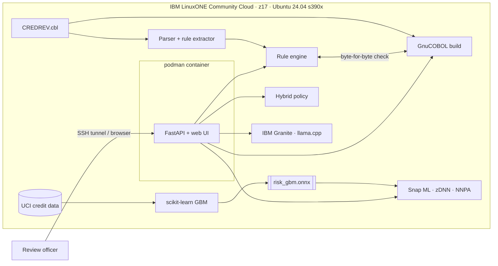

# LegacyLens

**[TEAM NAME_IBM Z Datathon 2026 Project]** · Theme: Real-Time AI for Critical Decisions · Event code SSF2026

LegacyLens reads a legacy COBOL credit policy, turns every decision path into a readable rule, proves the rules match the compiled program, and then adds a real-time AI risk check and a plain-English explanation. Everything runs on an **IBM LinuxONE** virtual server (IBM z17, s390x) in the LinuxONE Community Cloud.

```
COBOL source ─► parse & extract rules ─► verify vs compiled COBOL (GnuCOBOL on s390x)
                                             │
account ─► policy decision (rule + COBOL lines)
        ─► AI default risk (ONNX model, Snap ML on the z17 AI accelerator)
        ─► hybrid decision (AI can hold or escalate, never approve)
        ─► explanation (IBM Granite on LinuxONE, checked against the facts)
```

## The problem

Banks still make critical, high-volume decisions in COBOL: credit limits, card blocks, claims. The rules are buried in decades-old code. The people who wrote them are retiring, and changing them is risky because nobody can say exactly what they do.

Adding AI to these decisions makes this worse unless three things hold:
1. **We know what the legacy rules do.** Every decision traces to the lines of code that made it.
2. **We can prove it.** The extracted rules give exactly the same answers as the running program.
3. **The AI is fast, safe and explainable.** It scores in real time, it cannot approve anything on its own, and every decision comes with a reason a person can check.

## What LegacyLens does

| Step | How | Where in the repo |
|---|---|---|
| Read the COBOL | A parser for a documented subset of COBOL: fields and PICTUREs, 88-level conditions, IF/ELSE, EVALUATE, PERFORM, MOVE, COMPUTE | `legacylens/cobol.py`, `numeric.py` |
| Extract rules | Every path through the decision paragraph becomes a rule: the conditions tested, with their line numbers, and the decision written. Conditional code that only computes working fields stays a derivation | `legacylens/rules.py` |
| Prove the rules | The same records go to the compiled program (GnuCOBOL on s390x) and to a rule engine that runs only the extracted rules. The whole output line is compared byte for byte | `legacylens/verify.py`, `scripts/verify_rules.py` |
| Score risk | A gradient-boosted model trained with scikit-learn on 30,000 real card accounts, exported to **ONNX**, and served by **IBM Snap ML on the z17 on-chip AI accelerator** (NNPA, through zDNN) | `legacylens/model.py`, `models/risk_gbm.onnx` |
| Decide | Policy plus AI: hold a risky limit increase, escalate an account, set review priority, or send a restrictive decision for a second look. The AI never approves on its own | `legacylens/hybrid.py` |
| Explain | The code writes a factual draft note from the computed values and a glossary of the COBOL names; **IBM Granite 3.3 2B**, running on LinuxONE (llama.cpp, big-endian GGUF), rewrites it in plain English. A guard rejects any rewrite that adds a number, a percentage or a decision word that is not in the draft, or that drops the decision or the rule id; the draft is shown instead. Granite also writes business documentation for every extracted rule | `legacylens/explain.py`, `glossary.py`, `scripts/document_rules.py` |
| Serve | FastAPI service and web UI, packaged as a container for podman on s390x, with systemd units | `legacylens/api.py`, `Containerfile`, `deploy/` |

The policy program, `cobol/CREDREV.cbl`, is a monthly credit line review written for this project in the style of a batch COBOL program. It reads one 29-byte account record per line and writes `ACCOUNT DECISION REASON UTILISATION`.

## Architecture



## How it uses IBM LinuxONE

- **On-chip AI accelerator.** The risk model is an ONNX file loaded by IBM Snap ML with `tree_format="zdnn_tensors"`, which runs tree inference on the z17 Neural Network Processing Assist (NNPA) through the zDNN library (`libzdnn0`). The same ONNX file also runs on Snap ML's CPU path and on the exact ONNX reference evaluator, and all three agree.
- **COBOL where COBOL lives.** The policy program is compiled with GnuCOBOL on s390x. Every rule is checked against that executable.
- **Generative AI on the same box.** IBM Granite runs in llama.cpp built for s390x with vector extensions, using big-endian GGUF weights. No account data leaves the server; there are no external API calls.
- **Platform.** The service runs as a rootless podman container (non-root user inside too), started by systemd through a Quadlet unit; Granite is a systemd user service. Only SSH is exposed; the UI is reached through an SSH tunnel.

Evidence: [docs/linuxone_system.txt](docs/linuxone_system.txt) (machine type 9175 = IBM z17, the `nnpa` CPU facility, Snap ML reporting `zdnn_tensors`) and the screenshots below.

| | |
|---|---|
|  |  |
| The `coboldecision` server in the LinuxONE Community Cloud (AI_LAB flavor) | A decision: COBOL says INCREASE (RULE-05), AI risk is MEDIUM, so the increase is held; Granite explains |
|  |  |
| Extracted rules with their lines and Granite's documentation | Rules vs compiled COBOL, model metrics, hybrid impact |

## Results (all measured on the LinuxONE server)

<!-- RESULTS -->
Numbers come from `results/*.json`, produced by the scripts in `scripts/`.

### Rules vs compiled COBOL
| Input set | Records | Same output line |
|---|---|---|
| All 30,000 UCI accounts | 30,000 | 30,000 |
| Boundary cases (each condition's turning point) | 260 | 260 |
| Random records (zeros, maxima, overflow) | 5,000 | 5,000 |
| **Total** | **35,260** | **100%** |

All 6 rules are exercised. The random set includes arithmetic overflow (a tiny limit with a large bill); the engine reproduces COBOL's high-order truncation exactly.

### Risk model (4,501 held-out test accounts)
| Metric | Value |
|---|---|
| ROC AUC | 0.777 |
| Average precision | 0.547 |
| High band (risk ≥ 33%): precision / recall | 57.2% / 52.1% |
| Test default rate | 22.1% |

| Runtime (same ONNX file) | One account | Risk-band agreement with exact ONNX |
|---|---|---|
| Snap ML on the AI accelerator (NNPA) | 0.015 ms | 100% |
| Snap ML on the CPU | 0.008 ms | 100% |
| ONNX reference evaluator (exact) | 2.6 ms | reference |
| scikit-learn | 0.136 ms | – |

For this small model (200 trees of depth 3), Snap ML's CPU path is slightly faster than the accelerator path. Both score an account in microseconds.

### Policy alone vs policy + AI (same test accounts)
| | Accounts | Defaulted next month |
|---|---|---|
| Policy grants a limit increase | 1,500 | 175 (11.7%) |
| Hybrid grants it (AI risk low) | 952 | 75 (7.9%) |
| Hybrid holds it for review | 548 | 100 (18.2%) |
| Early warnings (policy KEEP → review, AI risk high) | 250 | 122 (48.8%) |
| Review queue: urgent / normal / low priority | 219 / 537 / 232 | 54.8% / 15.5% / 15.1% |

The hybrid keeps **57% of the defaulters** among limit increases from getting one, and flags 250 accounts the policy would have left unchanged, half of which defaulted. The combination table was chosen on the validation accounts; these are test numbers.

### Explanations
IBM Granite 3.3 2B Instruct (Q4_0, big-endian) on the server's 3 vCPUs, no GPU. Eleven demo accounts, two from each scenario (`results/llm_bench.json`):

| | |
|---|---|
| Rewrites accepted by the guard | 9 of 11 |
| Rejected, draft note shown instead | 2 (both said the program would "keep" an account it sent to REVIEW) |
| Median time per explanation | 21 s (about 5 tokens/s) |
| Rule documentation accepted | 6 of 6 (`results/rule_docs.json`) |

We also tried the faster Granite 3.0 1B-A400M (about 4 s per explanation): only 1 of 11 rewrites passed the guard, so LegacyLens uses the 2B model. The decision appears at once; the explanation follows, and the demo accounts are explained in the background when the service starts. The guard catches added numbers and decision words but not every awkward phrasing, so the UI always shows the facts the explanation was written from.

## Run it on LinuxONE (Ubuntu 24.04, s390x)

```bash
sudo apt-get install -y gnucobol3 libzdnn0 python3-venv python3-sklearn python3-onnx python3-pandas python3-numpy podman cmake build-essential
python3 -m venv --system-site-packages ~/venv && ~/venv/bin/pip install -r requirements.txt
mkdir -p ~/data && cd ~/data && curl -LO "https://archive.ics.uci.edu/static/public/350/default+of+credit+card+clients.zip" && unzip default+of+credit+card+clients.zip && cd -

~/venv/bin/python scripts/verify_rules.py      # rules vs compiled COBOL  -> results/verification.json
~/venv/bin/python scripts/train_model.py       # ONNX model + runtimes     -> models/, results/model.json
~/venv/bin/python scripts/evaluate_hybrid.py   # policy vs hybrid          -> results/hybrid.json
~/venv/bin/python -m pytest tests              # unit tests
```

The explanation model (llama.cpp for s390x and a big-endian Granite GGUF):
```bash
git clone --depth 1 https://github.com/ggml-org/llama.cpp && cd llama.cpp
cmake -B build -DCMAKE_BUILD_TYPE=Release -DLLAMA_CURL=OFF -DGGML_NATIVE=OFF -DGGML_VXE=ON \
      -DCMAKE_C_FLAGS="-march=z16 -mtune=z16" -DCMAKE_CXX_FLAGS="-march=z16 -mtune=z16"
cmake --build build -j3 --target llama-server
curl -LO https://huggingface.co/taronaeo/Granite-3.3-2B-Instruct-BE-GGUF/resolve/main/granite-3.3-2b-instruct-be.Q4_0.gguf
./build/bin/llama-server -m granite-3.3-2b-instruct-be.Q4_0.gguf --host 127.0.0.1 --port 8080 -c 4096 -t 3
python scripts/document_rules.py     # Granite documentation for every rule -> results/rule_docs.json
```
(Ubuntu 24.04's GCC 13 does not know the z17 `-march=arch15`, so llama.cpp is built for z16, which runs on z17.)

The service, as a container managed by systemd (rootless podman, Quadlet):
```bash
cp ~/data/"default of credit card clients.xls" ~/data/uci_credit.xls
podman build -t legacylens -f Containerfile .
mkdir -p ~/.config/systemd/user ~/.config/containers/systemd
cp deploy/granite.service ~/.config/systemd/user/ && cp deploy/legacylens.container ~/.config/containers/systemd/
systemctl --user daemon-reload && systemctl --user enable --now granite && systemctl --user start legacylens
sudo loginctl enable-linger $USER
ssh -L 8800:127.0.0.1:8000 linux1@<server>     # from your laptop, then open http://localhost:8800
```

## Responsible AI

- **Behaviour only.** The model uses credit limit, repayment status, statements and payments. Sex, education, marital status and age are left out.
- **The AI cannot approve.** It can hold, escalate or ask for a second look. Approvals come only from the legacy policy, and a person reviews every change the AI makes.
- **Traceable.** Every decision names the COBOL rule and its line numbers, the risk band and the features that moved the score most.
- **Checked wording.** The LLM never sees a question it could answer wrongly: it only rewrites a note whose facts were computed by the rules and the model. Its rewrite is rejected if it adds a number, a percentage or a decision word that is not in the note, or leaves out the decision or the rule; then the note itself is shown.
- **Local.** Data, models and the LLM stay on the LinuxONE server.

## Limitations

- The parser covers the COBOL subset listed in `legacylens/cobol.py`. Anything else is reported as unsupported, never guessed. Real estates also need file I/O, copybooks, OCCURS, REDEFINES, packed decimals and CALL, which this version does not model.
- `CREDREV.cbl` was written for this project; it is not a bank's production program.
- The rule engine starts each record from the program's initial values. CREDREV assigns every field it reads before using it, so this holds here; a program that carries state between records would need more.
- The data set (Taiwan, 2005) is public and old. The model is a demonstration of the pipeline, not a credit model to deploy.
- Agreement on 35,260 records is strong evidence, not a proof.

## Open-source resources

| Resource | Use | Licence |
|---|---|---|
| [UCI Default of Credit Card Clients](https://doi.org/10.24432/C55S3H) (Yeh & Lien, 2009) | training and test data | CC BY 4.0 |
| [GnuCOBOL](https://gnucobol.sourceforge.io/) 3.1.2 | compiles and runs CREDREV on s390x | GPL-3.0 |
| [IBM Snap ML](https://snapml.readthedocs.io/) 1.17.2 | ONNX import and inference on the AI accelerator | IBM licence (PyPI) |
| [zDNN](https://github.com/IBM/zDNN) (libzdnn0) | NNPA access for Snap ML | Apache-2.0 |
| [scikit-learn](https://scikit-learn.org/), [skl2onnx](https://github.com/onnx/sklearn-onnx), [ONNX](https://onnx.ai/) | training, export, exact reference evaluation | BSD-3 / Apache-2.0 |
| [llama.cpp](https://github.com/ggml-org/llama.cpp) | LLM inference on s390x | MIT |
| [IBM Granite 3.3 2B Instruct](https://huggingface.co/ibm-granite/granite-3.3-2b-instruct), big-endian GGUF from the [s390x verified models](https://huggingface.co/collections/taronaeo/s390x-verified-models-672765393af438d0ccb72a08) listed in llama.cpp's s390x guide | explanations and rule documentation | Apache-2.0 |
| [FastAPI](https://fastapi.tiangolo.com/), [uvicorn](https://www.uvicorn.org/), [pandas](https://pandas.pydata.org/), [NumPy](https://numpy.org/) | service and data handling | MIT / BSD |
| [podman](https://podman.io/), Ubuntu 24.04 | container and OS | Apache-2.0 / various |

## How this was built

DISCLOSURE_PLACEHOLDER

## Licence

Apache-2.0 (see `LICENSE`).
